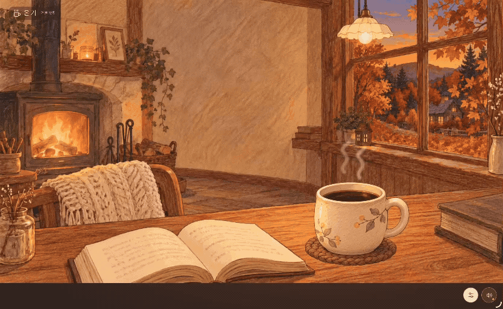

# Ongi (온기) ☕

A cozy, interactive web space for studying, relaxing, and enjoying peaceful moments.

Ongi is a personal web project designed to create a warm and comfortable atmosphere through seasonal illustrations, ambient sounds, and subtle animations.

## Features

- **Seasonal Scenery** — Switch between illustrated seasonal backgrounds
- **Ambient Sounds** — Enjoy relaxing fireplace sounds with volume controls
- **Interactive Drinks** — Choose different drinks to match your mood
- **Subtle Animations** — Steam, snowfall, and fireplace lighting effects
- **Smooth Transitions** — Gentle fade transitions between scenes
- **Responsive Design** — Optimized for desktop, tablet, and mobile screens
- **Accessibility** — Reduced-motion support and audio controls

## Tech Stack

- TypeScript
- Vite
- HTML5 Canvas
- CSS

## Project Goals

- Create a peaceful digital space for studying and relaxation
- Explore interactive visual effects and animations
- Build an immersive experience with illustrations and ambient audio
- Provide a comfortable experience across different devices

## Design Concept

Ongi (온기) means "warmth" in Korean.

The project is inspired by the feeling of sitting in a small, cozy tea house on a cold day.

Soft colored-pencil illustrations, warm lighting, seasonal scenery, and gentle ambient sounds come together to create a calm and welcoming atmosphere.

## Status

The core interactive experience is implemented.

Further improvements will focus on performance, stability, and overall user experience.

## Preview

